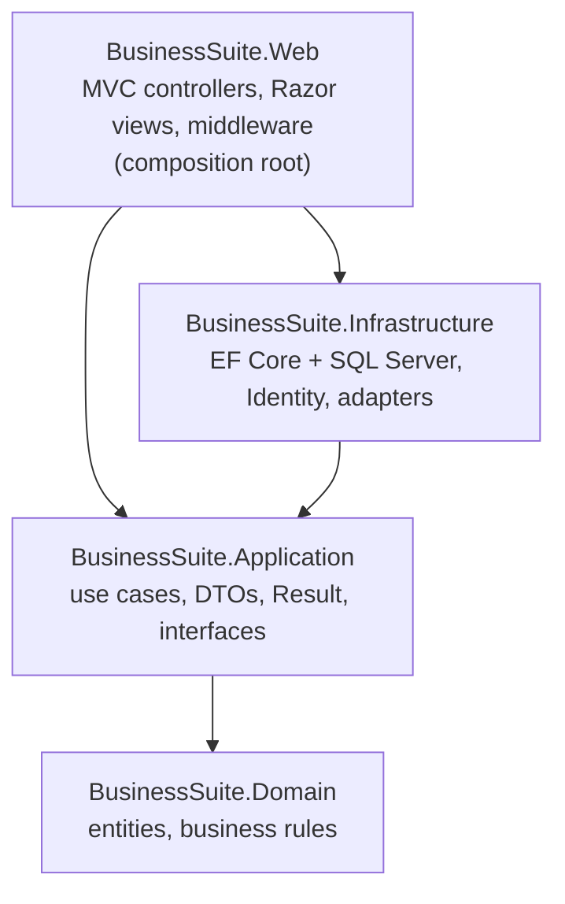
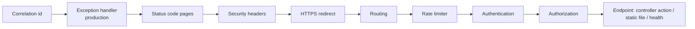

# Architecture

BusinessSuite is a **modular monolith**: one deployable web application, internally split into layers
(projects) and, from Phase 2, business modules (folders and MVC areas). This keeps hosting cheap and
debugging simple, while the boundaries make it possible to split pieces out later if ever needed.

## 1. Layers and dependency rules



Arrows point in the direction of a project reference. Dependencies only point **inwards**:

| Project | May reference | Must never reference | Enforced by |
|---|---|---|---|
| Domain | nothing | any other project, EF Core, ASP.NET Core, Microsoft.Extensions | project file + `LayerDependencyTests` |
| Application | Domain, `Microsoft.Extensions.*` abstractions | Infrastructure, Web, SQL Server provider, ASP.NET Core | project file + `LayerDependencyTests` |
| Infrastructure | Application (and so Domain), EF Core, Identity | Web | project file + `LayerDependencyTests` |
| Web | Application, Infrastructure | — (it is the composition root) | `ControllerConventionTests` keeps controllers thin |

**Why:** business rules (Domain/Application) can be unit-tested without a database or web server, and
technical details (SQL Server, Identity, payment providers) can change without touching business code.

### Responsibilities

| Project | Responsibilities |
|---|---|
| **Domain** | Entities (`Entity`, `AuditableEntity`), value objects, enums, rule-enforcing methods, `DomainException`. |
| **Application** | Application services (one per feature), DTOs, `Result`/`Error`, paging, options classes, interfaces implemented by outer layers (`ICurrentUser`; later `IAppDbContext`, `IEmailSender`, `IPaymentProvider`, `IFiscalInvoiceGateway`). Server-side validation and entitlement checks. |
| **Infrastructure** | `AppDbContext`, entity configurations, migrations, EF interceptors (auditing, later tenant guard), Identity user/role/sign-in rules, implementations of Application interfaces, health checks. |
| **Web** | HTTP pipeline, controllers, view models, Razor views, view components, authorization policies, cookies, rate limiting, security headers, correlation ids, error pages. |
| **Tests.Unit** | Domain/Application logic, framework building blocks, architecture rules. |
| **Tests.Integration** | The real app in memory (`WebApplicationFactory`), and data tests against real SQL Server. |

## 2. Request lifecycle

Every request passes the middleware in the order written in `Program.cs`:



Inside an MVC action:

```text
Controller (thin)  ->  Application service  ->  Domain entities + IAppDbContext (Phase 2+)  ->  EF Core  ->  SQL Server
      |                        |
  view model  <--  DTO / Result<T>
```

* Controllers validate the **shape** of input (data annotations) and call one service.
* Services validate **business rules**, check permissions/entitlements/tenant ownership, and return `Result`.
* Views render view models only; they never receive EF Core entities.

## 3. Routes and controllers (Phase 1)

| Method | Route | Controller.Action | Access | Purpose |
|---|---|---|---|---|
| GET | `/`, `/Dashboard` | `DashboardController.Index` | Signed-in | Dashboard |
| GET | `/Account/Login` | `AccountController.Login` | Anonymous | Sign-in form |
| POST | `/Account/Login` | `AccountController.Login` | Anonymous, rate-limited | Sign in |
| POST | `/Account/Logout` | `AccountController.Logout` | Signed-in | Sign out |
| GET | `/Account/AccessDenied` | `AccountController.AccessDenied` | Anonymous | 403 page |
| GET | `/Account/Lockout` | `AccountController.Lockout` | Anonymous | Locked-out page |
| ANY | `/Error` | `ErrorController.Index` | Anonymous | Unhandled-exception page (production) |
| ANY | `/Error/{statusCode}` | `ErrorController.Status` | Anonymous | 400/403/404/405/429 pages |
| GET | `/health/live` | health check endpoint | Anonymous | Process is up |
| GET | `/health/ready` | health check endpoint | Anonymous | SQL Server reachable |
| GET | `/{**static files}` | `MapStaticAssets` | Anonymous | CSS, JS, fonts, images |

Conventional routes: `{area:exists}/{controller=Dashboard}/{action=Index}/{id?}` and
`{controller=Dashboard}/{action=Index}/{id?}`. The list of anonymous actions is fixed by
`ControllerConventionTests.ApprovedAnonymousActions`.

## 4. Module structure (Phase 2 onwards)

A business module (for example Inventory) is a vertical slice across the layers, always with the same shape:

```text
src/BusinessSuite.Domain/Inventory/                     StockMovement.cs, StockMovementType.cs
src/BusinessSuite.Application/Features/Inventory/       IStockService.cs, StockService.cs, DTOs, commands
src/BusinessSuite.Infrastructure/Persistence/Configurations/StockMovementConfiguration.cs
src/BusinessSuite.Web/Areas/Inventory/Controllers/      StockController.cs  ([Area("Inventory")])
src/BusinessSuite.Web/Areas/Inventory/Views/Stock/      Index.cshtml, ...
src/BusinessSuite.Web/Models/Inventory/ (or inside the area)  view models
tests/.../Inventory/                                     unit + integration tests
```

Step-by-step recipes are in [DEVELOPER_GUIDE.md](DEVELOPER_GUIDE.md).

## 5. Cross-cutting concerns

| Concern | How it works | Where |
|---|---|---|
| Configuration | Options classes bound from appsettings, validated at start-up (`ValidateOnStart`) | `*Options`/`*Settings` classes; [CONFIGURATION.md](CONFIGURATION.md) |
| Logging | `Microsoft.Extensions.Logging`; JSON console in production, readable console in development; every line carries a `CorrelationId` scope | `appsettings*.json`, `CorrelationIdMiddleware` |
| Errors | Expected failures → `Result`/`Error`; unexpected → exception → logged, friendly page with reference id | `Result.cs`, `ErrorController` |
| Time | Inject `TimeProvider`; store UTC `DateTimeOffset` named `...AtUtc`; convert for display only | `DashboardService` example |
| Money | `decimal` only; default `decimal(18,4)` in SQL; rounding policy defined with invoicing (Phase 3) | `AppDbContext.ConfigureConventions` |
| Auditing | Created/updated stamps automatic for `IAuditable`; business audit log in Phase 2 | `AuditableEntityInterceptor` |
| Security | Fallback "signed-in" policy, CSRF, CSP, headers, rate limit, secure cookies | [SECURITY.md](SECURITY.md) |
| Tenancy | Phase 2: server-resolved organization, `ITenantOwned`, filters + explicit checks | [SECURITY.md](SECURITY.md) §4 |

## 6. Multi-tenancy model (designed now, built in Phase 2)

* **Shared database, shared schema**: every organization-owned row carries `OrganizationId`.
  Cheapest to run and simplest to operate; isolation is enforced in code and tested.
* A user may belong to several organizations (`OrganizationMembership`: user, organization, role, branches, status).
* The current organization is chosen by the user from their memberships, stored server-side
  (cookie claim re-validated against the database), and exposed as `ICurrentUser.OrganizationId`.
  It is **never** read from a form field, query string or URL.
* EF Core global query filters on `ITenantOwned` entities are a safety net; services still check
  ownership explicitly, and `SaveChanges` rejects writes for another organization.
* Platform administrators use separate, explicit, audited cross-tenant services.

## 7. Decision log

| # | Decision | Reason | Alternatives considered |
|---|---|---|---|
| D-01 | Modular monolith, ASP.NET Core MVC + Razor views | One deployment, low hosting cost, server-rendered UI works on slow connections | Microservices, React/Angular SPA (unnecessary complexity now) |
| D-02 | Clean Architecture with 4 projects, dependencies inward | Testable business rules, replaceable infrastructure | Single project (harder to keep rules out of controllers) |
| D-03 | `Guid` keys generated by EF Core (sequential) | Safe to expose, mergeable, index-friendly on SQL Server | `int` identity (guessable ids, harder data merges) |
| D-04 | Instants stored as UTC `DateTimeOffset` named `...AtUtc` | No time-zone ambiguity; organizations display in their own zone | `DateTime` (Kind bugs) |
| D-05 | From Phase 2, Application services use an `IAppDbContext` interface (EF Core abstractions) directly; no generic repository | LINQ is already a repository; less code to maintain | Generic repositories (extra layer with no value) |
| D-06 | `Result`/`Error` for expected failures, exceptions for unexpected ones | Clear control flow, friendly messages, testable | Exceptions for validation (hidden flow, costly) |
| D-07 | One `AppDbContext`, one SQL schema per module | Simple transactions across modules; self-describing database | DbContext per module (cross-module transactions get hard) |
| D-08 | Identity users in Infrastructure; platform roles = Identity roles; organization roles = memberships | One person can have different roles in different businesses | Organization roles as Identity roles (cannot be per organization) |
| D-09 | Fallback authorization policy + approved-anonymous test | New endpoints are protected even if someone forgets `[Authorize]` | Opt-in `[Authorize]` (easy to forget) |
| D-10 | Strict CSP, vendored front-end libraries, no CDN | XSS defence in depth; works fully offline | CDN (external dependency, weaker CSP) |
| D-11 | Central package versions + `global.json` (latestFeature) | One place to update packages; predictable SDK | Versions per project (drift) |
| D-12 | Built-in logging (console/JSON), Serilog optional later | No extra dependency; hosting platforms collect stdout | Serilog from day one |
| D-13 | Migrations auto-applied only in Development; production uses a reviewed idempotent script or bundle | No surprise schema changes in production | `Migrate()` at production start-up; `EnsureCreated()` (never) |
| D-14 | Data tests use real SQL Server; HTTP tests use `WebApplicationFactory` | In-memory provider does not behave like SQL Server | EF in-memory provider |
| D-15 | Shared-database multi-tenancy with `OrganizationId` | Lowest cost for many small customers | Database per tenant (higher cost/operations; possible later for Enterprise plans) |
