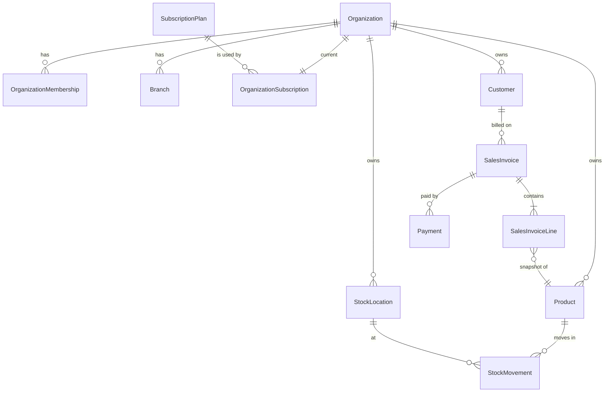

# Database design

SQL Server, accessed through EF Core 10 code-first migrations. One database, one `AppDbContext`,
one SQL schema per module.

## 1. Conventions

| Topic | Rule |
|---|---|
| Schemas | `identity`, `platform`, `audit`, `catalog`, `inventory` (implemented); planned `purchasing`, `sales`, `finance`. Names live in `DatabaseSchemas.cs`. |
| Tables | PascalCase, plural (`identity.Users`, `sales.Invoices`). One `IEntityTypeConfiguration<T>` class per entity in `Persistence/Configurations`. |
| Keys | `Guid Id`, generated by EF Core as **sequential** GUIDs when the entity is added (fast clustered index). |
| Foreign keys | Always configured explicitly with `OnDelete(...)`. Default for business data: `DeleteBehavior.Restrict`. |
| Instants | `DateTimeOffset` in UTC, named `...AtUtc` (`CreatedAtUtc`). Dates without time (invoice date, expiry date): `DateOnly`. |
| Money & quantities | `decimal` only. Convention: `decimal(18,4)`. Rounding to the currency's minor unit happens in the Domain when totals are calculated (policy defined in Phase 3, see §6). |
| Strings | Always give a maximum length (`HasMaxLength`). Codes (SKU, invoice number) unique per organization. |
| Audit stamps | Entities implementing `IAuditable` get `CreatedAtUtc`, `CreatedByUserId`, `UpdatedAtUtc`, `UpdatedByUserId` automatically. |
| Concurrency | Documents that several people edit (invoices, stock levels) get a `rowversion` column (`IsRowVersion()`); conflicts become `Error.Conflict`. |
| Tenant ownership | From Phase 2 every organization-owned table has a non-null `OrganizationId` with an index that starts with it. |

## 2. Phase 1 schema (implemented)

| Table | Purpose | Notes |
|---|---|---|
| `identity.Users` | Sign-in accounts | Identity columns + `DisplayName` (100), `IsActive`, `CreatedAtUtc`, `CreatedByUserId`, `UpdatedAtUtc`, `UpdatedByUserId` |
| `identity.Roles` | Platform roles (e.g. `PlatformAdministrator`) | + `Description` (256) |
| `identity.UserRoles` | User ↔ platform role | |
| `identity.UserClaims`, `identity.RoleClaims` | Extra claims | Keep small |
| `identity.UserLogins`, `identity.UserTokens` | External logins, 2FA/reset tokens | Used from Phase 2 |
| `dbo.__EFMigrationsHistory` | Applied migrations | Managed by EF Core |

## 3. Planned entities and tenant ownership

| Entity | Schema | Phase | Owned by | Key constraints |
|---|---|---|---|---|
| Organization | platform | 2 | — (is the tenant) | unique `Slug`; legal/display names, tax ids, currency, time zone, fiscal year start, number formats, status |
| OrganizationMembership | platform | 2 | Organization | unique (OrganizationId, UserId); role, status |
| Branch | platform | 2 | Organization | unique (OrganizationId, Code). **Implemented** with the inventory schema |
| Permission / RolePermission | platform | 2 | Organization (custom roles) | fine-grained permissions per organization role |
| SubscriptionPlan, PlanEntitlement | platform | 2 | Platform | unique plan `Code`; entitlement (PlanId, Key) |
| OrganizationSubscription, SubscriptionHistory | platform | 2 | Organization | one current subscription per organization |
| SubscriptionPaymentEvent | platform | 5 | Organization | unique (Provider, ProviderEventId) for idempotent webhooks |
| AuditLog | audit | 2 | Organization (nullable for platform actions) | append-only. **Implemented** (`audit.AuditLogs`, migration `AddAuditLog`): `OccurredAtUtc`, `OrganizationId?`, `ActorUserId?`, `Action` (100), `EntityType` (50), `EntityId?`, `Details` (JSON), `CorrelationId` (64), `IpAddress` (45); indexes (OrganizationId, OccurredAtUtc), (EntityType, EntityId), (ActorUserId); no foreign keys (entries outlive what they describe); trigger `TR_AuditLogs_AppendOnly` refuses UPDATE/DELETE |
| Catalogue: categories, units and conversions, products, variants, configurable attributes | catalog | 3 | Organization | **Implemented** (migration `AddInventory`): see [INVENTORY_DATABASE.md](INVENTORY_DATABASE.md). Brands are an organization-defined attribute |
| TaxRate / TaxRule | catalog | 3 | Organization | per jurisdiction, effective dates |
| Inventory: warehouses, batches, balances, stock ledger, adjustments, transfers | inventory | 3 | Organization (+ Branch) | **Implemented** (migration `AddInventory`): see [INVENTORY_DATABASE.md](INVENTORY_DATABASE.md) |
| Customer, Supplier | sales / purchasing | 3 | Organization | unique code per organization |
| PurchaseOrder, PurchaseOrderLine, GoodsReceipt, SupplierInvoice | purchasing | 3 | Organization | document numbers unique per organization |
| SalesOrder, SalesInvoice, SalesInvoiceLine, Payment, CreditNote | sales | 3 | Organization | invoice number unique per (OrganizationId, Series); lines keep a snapshot of product name, price, tax |
| Expense, ExpenseCategory, PaymentMethod | finance | 3 | Organization | |

Stock on hand is **derived** from the `StockMovement` ledger (optionally cached in a balance table that is
updated in the same transaction). Historical movements are never edited; corrections are reversing movements.

## 4. Deletion and retention

| Data | Rule |
|---|---|
| Financial documents (invoices, payments, receipts, credit notes) | Never hard-deleted. Use status changes (Cancelled) and reversing documents. |
| Stock movements | Never edited or deleted; reverse with a new movement. |
| Master data (products, customers, suppliers) | Deactivate (`IsActive = false`) once referenced; hard delete only if never used. |
| Users | Deactivate; never delete while referenced by records. |
| Audit log | Append-only; retention period configurable per jurisdiction (confirm local tax-record requirements). A future purge job must run under a separate, privileged login that disables `TR_AuditLogs_AppendOnly` for the purge only; the application's login never can. |
| Soft delete (`IsDeleted` + filter) | Only where a clear "recycle bin" requirement exists. Not used for financial data. |

## 5. Migrations workflow

Migrations are C# files generated by `dotnet ef` into `src/BusinessSuite.Infrastructure/Persistence/Migrations`
and committed with the code that needs them.

| Step | Command | Notes |
|---|---|---|
| Create | `./scripts/db.ps1 add <DescriptiveName>` | e.g. `AddProducts`, `AddInvoiceNumberIndex` |
| Review | open `<timestamp>_<Name>.cs` | check table/column names, types, lengths, nullability, indexes, `onDelete`, and that nothing is dropped unexpectedly |
| Apply locally | `./scripts/db.ps1 update` | Development also applies pending migrations at start-up |
| List | `./scripts/db.ps1 list` | shows applied/pending |
| Roll back locally | `./scripts/db.ps1 update <PreviousMigrationName>` | runs the `Down()` methods; `update 0` empties the schema |
| Undo the last, unapplied migration | `./scripts/db.ps1 remove` | only if it was never applied to a shared database |
| Production | `./scripts/db.ps1 script` → review `artifacts/migrations.sql` → back up → run it | idempotent: safe to run twice |
| Production (alternative) | `./scripts/db.ps1 bundle` → `efbundle --connection "<conn>"` | a single executable for deployment pipelines |

Rules:

* Never edit a migration that has been applied to a shared or production database; add a new one.
* Never use `EnsureCreated()`; never drop or recreate production databases automatically.
* Destructive changes (drop/rename column) go in two releases: add new → copy data → remove old.
* The test `Model_has_no_pending_changes` fails when the model changed without a migration.
* Migrations run automatically at start-up **only** in Development (`Database:ApplyMigrationsOnStartup`).

## 6. Transactions, concurrency and money (applies from Phase 3)

* Business operations that touch several tables (confirm invoice: lines + stock movements + customer balance)
  run in ONE transaction: `await using var tx = await db.Database.BeginTransactionAsync(ct);`.
* If `Database:MaxRetryCount` > 0 (retry on transient errors), wrap such code in
  `db.Database.CreateExecutionStrategy().ExecuteAsync(...)`, otherwise EF Core throws.
* Overselling is prevented by checking and writing stock inside the same transaction with a concurrency
  token (rowversion) on the stock balance row, retrying or failing with `Error.Conflict`.
* Totals are always recalculated on the server from line quantities, prices, discounts and tax rates; the
  browser's numbers are ignored. Rounding: per line to the currency's minor units with
  `MidpointRounding.AwayFromZero`, then summed (final rule confirmed against the tax authority's requirements in Phase 3).

## 7. Backups and recovery

* Production: full backup daily, differential every few hours, transaction-log backups every 15 minutes
  (full recovery model). Keep copies off the server.
* Test a restore at least monthly; a backup that was never restored is not a backup.
* Before every production migration: take a backup.
* Local LocalDB/Docker databases are disposable: `./scripts/db.ps1 update 0` then `./scripts/db.ps1 update` rebuilds them.
