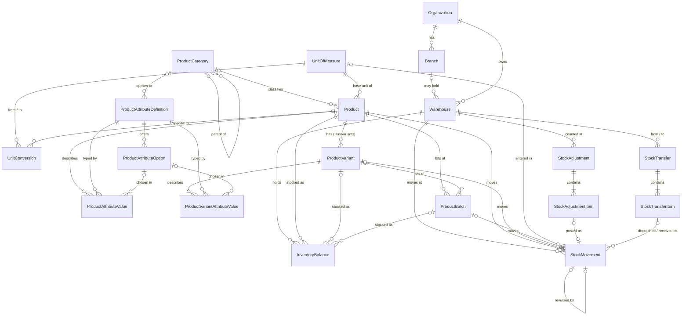

# Inventory & catalogue database design

Relational design of the Inventory module (EF Core 10, SQL Server). It serves FMCG, grocery, electronics, clothing,
wholesale and general retail from **one set of tables**: nothing in the schema knows an industry. What differs between
businesses (brand, RAM, size, colour, volume, warranty...) is *data*: each organization defines its own attributes.

General conventions (keys, `decimal`, `...AtUtc`, `OnDelete`) are in [DATABASE_DESIGN.md](DATABASE_DESIGN.md).
This document was written before the implementation; the implementation follows it.

## 1. Schemas and tables

| Schema | Table | Entity | Purpose |
|---|---|---|---|
| `platform` | `Branches` | `Branch` | A shop/office of an organization; warehouses may belong to one |
| `catalog` | `ProductCategories` | `ProductCategory` | Hierarchical categories (self reference) |
| `catalog` | `UnitsOfMeasure` | `UnitOfMeasure` | pcs, kg, carton...; says how many decimals a quantity may have |
| `catalog` | `UnitConversions` | `UnitConversion` | 1 *From* = *Factor* x *To*; general (1 kg = 1000 g) or for one product (1 carton = 24 pcs) |
| `catalog` | `Products` | `Product` | The sellable thing. Simple (has its own stock) or with variants |
| `catalog` | `ProductAttributeDefinitions` | `ProductAttributeDefinition` | An attribute an organization defined ("RAM", "Size"), with a data type |
| `catalog` | `ProductAttributeOptions` | `ProductAttributeOption` | Allowed values of Dropdown / MultiSelect attributes |
| `catalog` | `ProductAttributeValues` | `ProductAttributeValue` | A product's value for a product-level attribute |
| `catalog` | `ProductVariants` | `ProductVariant` | One size/colour/... combination with its own SKU, barcode, prices and stock |
| `catalog` | `ProductVariantAttributeValues` | `ProductVariantAttributeValue` | A variant's value for a variant-level attribute |
| `inventory` | `Warehouses` | `Warehouse` | Place stock is held (warehouse, shop floor, van) |
| `inventory` | `ProductBatches` | `ProductBatch` | Optional lot with batch number and expiry date |
| `inventory` | `InventoryBalances` | `InventoryBalance` | Stock on hand per warehouse / product / variant / batch |
| `inventory` | `StockMovements` | `StockMovement` | The append-only ledger; the source of truth for stock history |
| `inventory` | `StockAdjustments`, `StockAdjustmentItems` | `StockAdjustment`, `StockAdjustmentItem` | Stock-count / write-off document |
| `inventory` | `StockTransfers`, `StockTransferItems` | `StockTransfer`, `StockTransferItem` | Move stock between warehouses (via "in transit") |

## 2. ER diagram

Every table also has a mandatory `OrganizationId` to `platform.Organizations` (not drawn, to keep the diagram readable).

## 3. How the requirements are met

### 3.1 Tenant isolation

* **Every organization-owned table has a non-null `OrganizationId`** (the `ITenantOwned` interface in the Domain), and every
  index and unique constraint starts with it.
* **The database itself refuses cross-tenant references.** Each parent table declares an alternate key
  `(OrganizationId, Id)`, and each child references the parent with the *composite* foreign key
  `(OrganizationId, ParentId)`. A product of organization A can therefore never point at a category, unit, warehouse or
  batch of organization B, even through a bug in the application. (For an optional reference, a `NULL` id skips the
  check; the organization column is never null.)
* Two relationships need more than the organization:
  a variant belongs to *its* product (`(OrganizationId, ProductId, Id)` is a key of `ProductVariants`), an option belongs to
  *its* attribute definition, and a batch to *its* product, in the same way.
* The application still resolves the organization on the server (`ICurrentUser.OrganizationId`) and filters every query;
  the constraints above are the safety net, not a replacement.

### 3.2 Configurable attributes without schema changes

* An organization adds an attribute by inserting a **`ProductAttributeDefinition`** row: `Code` (stable, e.g. `ram`),
  `Name`, `DataType`, `Scope` (does it describe the *product* or each *variant*?), `IsRequired`, optional `UnitLabel`
  ("GB", "ml"), optional restriction to a `CategoryId`.
* **Data types:** `Text`, `Number` (whole), `Decimal`, `Date`, `Boolean`, `Dropdown` (one option), `MultiSelect` (several
  options). `DataType` never changes after creation (it would invalidate stored values).
* Allowed choices of Dropdown/MultiSelect attributes are **`ProductAttributeOption`** rows.
* A value is one row in `ProductAttributeValues` (product scope) or `ProductVariantAttributeValues` (variant scope) with
  **typed columns**, so values can be filtered and sorted in SQL, not parsed from JSON:

| Column | Used for |
|---|---|
| `TextValue` nvarchar(500) | Text |
| `NumberValue` decimal(28,8) | Number, Decimal |
| `DateValue` date | Date |
| `BooleanValue` bit | Boolean |
| `OptionId` | Dropdown (one row), MultiSelect (one row per chosen option) |

* A `CHECK` constraint guarantees **exactly one** column is filled. Unique indexes allow one row per (owner, attribute) for
  single-valued types and one row per (owner, attribute, option) for MultiSelect.
* The application validates the value against the definition's `DataType`, `IsRequired` and options before saving.
* Examples (all the same tables): FMCG `Brand` (Dropdown), `Volume` (Decimal, "ml"); electronics `Model` (Text), `RAM`
  (Dropdown), `Storage` (Dropdown), `Warranty` (Number, "months"); clothing `Size` and `Color` (Dropdown, variant scope),
  `Fabric` (Dropdown), `Gender` (Dropdown).
* **Batch number and expiry date are not attributes**: they belong to a received lot of stock, not to the product (section 3.5).

### 3.3 Simple products and variants

* `Product.HasVariants = false`: a **simple product**. It has its own `Sku`, prices and stock; `ProductVariantId` is `NULL`
  everywhere it is referenced.
* `Product.HasVariants = true`: the product is a template (the "style"); each size/colour combination is a
  **`ProductVariant`** with its own unique `Sku`, `Barcode`, prices, reorder level, variant attribute values and stock.
* Stock tables (`InventoryBalances`, `StockMovements`, `ProductBatches`, document items) reference
  `ProductId` + nullable `ProductVariantId`. The application requires the variant exactly when `HasVariants` is true.
* A `ProductVariant` row can only reference a product of the same organization, and a stock row can only reference a
  variant *of that product* (composite foreign key `(OrganizationId, ProductId, ProductVariantId)`).
* SKU rules: unique per organization within `Products` and within `ProductVariants`; the application also refuses a SKU that
  exists in the other table (a scan must identify one thing). Barcodes: unique per organization when present.

### 3.4 Warehouses and branches

* `Branches` belong to an organization; `Warehouses.BranchId` is optional, so a single-shop business needs no branch at all.
* Stock is always per warehouse. A warehouse is retired (`IsActive = false`), never deleted once used.

### 3.5 Optional batch and expiry tracking

* `Product.TracksBatches` switches it on per product; `Product.RequiresExpiry` additionally demands an expiry date on each
  batch. Products that do not track batches never have a `BatchId`.
* `ProductBatches`: `BatchNumber` unique per product/variant, `ManufactureDate`, `ExpiryDate` (`DateOnly`), with a check
  that expiry is not before manufacture. Stock of a batch is its own `InventoryBalances` row, so FEFO reports and expiry
  alerts are plain queries.

### 3.6 Units and conversions

* Every product has a `BaseUnitId`. **Quantities in balances and the ledger are always in the base unit.**
* `UnitConversions` convert other units to it: with `ProductId = NULL` a general factor (1 kg = 1000 g), with a product a
  product-specific one (1 carton of *this* biscuit = 24 pcs). Factor is `decimal(18,6)`, greater than zero, and
  `FromUnitId <> ToUnitId` (checks).
* A movement keeps what the user typed (`EnteredUnitId`, `EnteredQuantity`) next to the base-unit `Quantity`, so a
  receipt of "5 cartons" stays visible as such.
* `UnitOfMeasure.DecimalPlaces` (0 to 4) limits how fine a quantity may be (pieces 0, kilograms 3).

### 3.7 Balances, ledger and history

* **`InventoryBalances`** = current quantity and moving-average cost per (warehouse, product, variant, batch). Exactly one
  row per combination (unique index; `NULL` variant/batch compare equal in a SQL Server unique index, so a simple,
  batch-less product has exactly one row per warehouse). The index is deliberately *unfiltered* (`HasFilter(null)`): EF Core
  would otherwise add `WHERE ... IS NOT NULL` to a unique index on nullable columns and allow duplicates. The same applies
  to categories (per parent), unit conversions (general ones), batch numbers and document lines.
* **`StockMovements`** = the ledger. Each movement stores its **signed base-unit quantity**, unit cost, the quantity on hand
  *after* it (`QuantityAfter`), type, time, the user (audit stamps), a reference and a **source document**
  (`SourceType`/`SourceId`/`SourceLineId`, e.g. an adjustment item; later purchase and sales documents).
* A balance changes **in the same transaction** as the movement that changes it.
* **Movement types:** `OpeningBalance`, `Receipt`, `Issue`, `AdjustmentIncrease`, `AdjustmentDecrease`, `TransferOut`,
  `TransferIn`, `ReversalIncrease`, `ReversalDecrease`.

### 3.8 Never delete posted history

* `StockMovements` has an `INSTEAD OF UPDATE, DELETE` trigger that refuses every change: **movements are append-only**.
  A mistake is corrected by a new reversing movement whose `ReversesMovementId` points at the original (a unique index
  allows a movement to be reversed once).
* Foreign keys into posted data are `RESTRICT`, so referenced rows cannot be removed either.
* `StockAdjustments` and `StockTransfers` carry a status. A trigger refuses to delete any document that is not `Draft`
  (and so, via the restricted keys, its items). Posted documents are corrected by a new document, never edited.
* **Posted documents are also immutable against UPDATE** (migration `AddStockPostingIntegrity`; AFTER triggers, error numbers
  in brackets): a header whose stored status is final (adjustment Posted/Cancelled, transfer Received/Cancelled) cannot be updated or
  reopened (51013, 51014); lines of a document that is no longer a draft cannot be added or removed, and cannot change except to
  be linked ONCE to the ledger movement they became, which posting itself needs (a transfer line also receives its cost and
  received quantity once) (51015, 51016). The triggers look at the status before the update and do not depend on the order in
  which EF Core saves the header and its lines. They hold against bugs and direct SQL; tests try both.
* Products, variants, warehouses, units, batches: deactivated (`IsActive = false`), not deleted, once used.

### 3.9 Negative stock

* **Prevented by default.** `Product.AllowNegativeStock` is `false` unless an organization turns it on for a product.
  The domain (`InventoryBalance.Decrease`) refuses a decrease below zero unless the caller passes that flag, and the stock
  service reports `Stock.InsufficientStock`.
* *Known limit:* because the flag is per product (another table), the database cannot enforce "quantity >= 0" with a plain
  `CHECK`; the guarantee is the domain rule plus the row-version below. A future per-balance copy of the flag would let a
  `CHECK` back it up.

### 3.10 Transactions and concurrency

* Every stock operation (record a movement, post an adjustment, dispatch/receive a transfer) runs in **one database
  transaction** (`DatabaseTransactions.RunAsync`): the balance rows, movements and document status commit together or not at all.
* `InventoryBalances.RowVersion` (`rowversion`) is the concurrency token: two people issuing the same stock at once cannot both
  succeed on a stale quantity; the loser gets a conflict (`409`) and no change is made. The first movement of a new balance
  is protected by the unique index.
* `StockAdjustments` and `StockTransfers` also have a `RowVersion`, so a document cannot be posted twice concurrently.
* **A source line posts a given movement once.** The unique index `IX_StockMovements_SourceLine` covers (organization, source type,
  source id, source line, movement type, warehouse, product, variant, batch) for movements that have a source document and line.
  A retried or repeated posting, by an adjustment, a transfer or another module (Sales, Purchases), fails on the second insert
  instead of doubling the stock. `SourceId` is the document that POSTS (a delivery, not the order it fulfils), so partial
  deliveries are separate documents.

### 3.11 Precision and indexes

* Quantities, costs and prices: `decimal(18,4)` (model convention). Conversion factors and attribute decimals: `decimal(18,6)` / `decimal(28,8)`.
* Every list screen's filter has an index starting with `OrganizationId`: product name / category, variant by product,
  balance by warehouse, movements by (product, time), (warehouse, time) and source document, batches by expiry date.
* Text columns always have a maximum length; codes are unique per organization.

## 4. Relationship summary (cardinality, delete behaviour)

All foreign keys are composite with `OrganizationId` unless noted. Default delete behaviour is **Restrict**.

| Child | Parent | Cardinality | On delete | Notes |
|---|---|---|---|---|
| `ProductCategory.ParentCategoryId` | `ProductCategory` | N : 0..1 | Restrict | Tree; cycles refused by the application |
| `Product.CategoryId` | `ProductCategory` | N : 0..1 | Restrict | |
| `Product.BaseUnitId` | `UnitOfMeasure` | N : 1 | Restrict | |
| `UnitConversion.FromUnitId / ToUnitId` | `UnitOfMeasure` | N : 1 each | Restrict | |
| `UnitConversion.ProductId` | `Product` | N : 0..1 | Restrict | `NULL` = general conversion |
| `ProductVariant.ProductId` | `Product` | N : 1 | Restrict | |
| `ProductAttributeDefinition.CategoryId` | `ProductCategory` | N : 0..1 | Restrict | Limits where the attribute applies |
| `ProductAttributeOption.AttributeDefinitionId` | `ProductAttributeDefinition` | N : 1 | Restrict | |
| `ProductAttributeValue.ProductId` | `Product` | N : 1 | Restrict | |
| `ProductAttributeValue.AttributeDefinitionId` | `ProductAttributeDefinition` | N : 1 | Restrict | |
| `ProductAttributeValue.(AttributeDefinitionId, OptionId)` | `ProductAttributeOption` | N : 0..1 | Restrict | Option must belong to that definition |
| `ProductVariantAttributeValue.*` | same as above, for variants | | Restrict | |
| `Warehouse.BranchId` | `Branch` | N : 0..1 | Restrict | |
| `ProductBatch.ProductId` / `ProductVariantId` | `Product` / `ProductVariant` | N : 1 / N : 0..1 | Restrict | |
| `InventoryBalance.WarehouseId` | `Warehouse` | N : 1 | Restrict | |
| `InventoryBalance.ProductId` | `Product` | N : 1 | Restrict | |
| `InventoryBalance.(ProductId, ProductVariantId)` | `ProductVariant` | N : 0..1 | Restrict | Variant must belong to the product |
| `InventoryBalance.(ProductId, BatchId)` | `ProductBatch` | N : 0..1 | Restrict | Batch must belong to the product |
| `StockMovement.*` | same four references as the balance, plus `EnteredUnitId` to `UnitOfMeasure` | | Restrict | |
| `StockMovement.ReversesMovementId` | `StockMovement` | 0..1 : 0..1 | Restrict | Unique where not null |
| `StockAdjustment.WarehouseId` | `Warehouse` | N : 1 | Restrict | |
| `StockAdjustmentItem.StockAdjustmentId` | `StockAdjustment` | N : 1 | **Cascade** | Items live and die with a *draft* |
| `StockAdjustmentItem.StockMovementId` | `StockMovement` | 0..1 : 0..1 | Restrict | Set when posted |
| `StockTransfer.FromWarehouseId / ToWarehouseId` | `Warehouse` | N : 1 each | Restrict | Check: different warehouses |
| `StockTransferItem.StockTransferId` | `StockTransfer` | N : 1 | **Cascade** | |
| `StockTransferItem.DispatchMovementId / ReceiptMovementId` | `StockMovement` | 0..1 : 0..1 | Restrict | |

## 5. Constraint catalogue

| Table | Unique | Check |
|---|---|---|
| `ProductCategories` | (Org, ParentCategoryId, Name); (Org, Code) where Code not null | |
| `UnitsOfMeasure` | (Org, Code); (Org, Name) | DecimalPlaces between 0 and 4 |
| `UnitConversions` | (Org, ProductId, FromUnitId, ToUnitId) | Factor > 0; From <> To |
| `Products` | (Org, Sku); (Org, Barcode) where not null | prices and reorder level >= 0; RequiresExpiry implies TracksBatches; TracksBatches implies TracksStock |
| `ProductVariants` | (Org, Sku); (Org, Barcode) where not null | prices and reorder level >= 0 |
| `ProductAttributeDefinitions` | (Org, Code) | DataType and Scope in range |
| `ProductAttributeOptions` | (Org, AttributeDefinitionId, Label) | |
| `ProductAttributeValues` / `ProductVariantAttributeValues` | (Org, owner, definition) where OptionId is null; (Org, owner, definition, option) where not null | exactly one value column filled |
| `Warehouses` | (Org, Code); (Org, Name) | |
| `ProductBatches` | (Org, ProductId, ProductVariantId, BatchNumber) | ExpiryDate >= ManufactureDate |
| `InventoryBalances` | (Org, WarehouseId, ProductId, ProductVariantId, BatchId) | (negative stock: see 3.9) |
| `StockMovements` | (ReversesMovementId) where not null; `IX_StockMovements_SourceLine` (Org, SourceType, SourceId, SourceLineId, Type, WarehouseId, ProductId, ProductVariantId, BatchId) where source id and line not null | Quantity <> 0; sign matches type |
| `StockAdjustments` / `StockTransfers` | (Org, Number) | Status in range; transfer From <> To |
| items | (document, product, variant, batch) per document | Quantity <> 0 (adjustment) / > 0 (transfer) |

## 6. Services and what is still out of scope

The services and API for these tables exist: [API.md §10](API.md#10-inventory-and-catalogue). Purchasing and sales write to the
same ledger through `IStockPostingService` (`SourceType`/`SourceId`/`SourceLineId`), never directly. Screens are still to come.
Stock reservations (the `QuantityReserved` column is maintained by sales orders, a later module), serial numbers and costing
methods other than the moving weighted average are not modelled yet.
