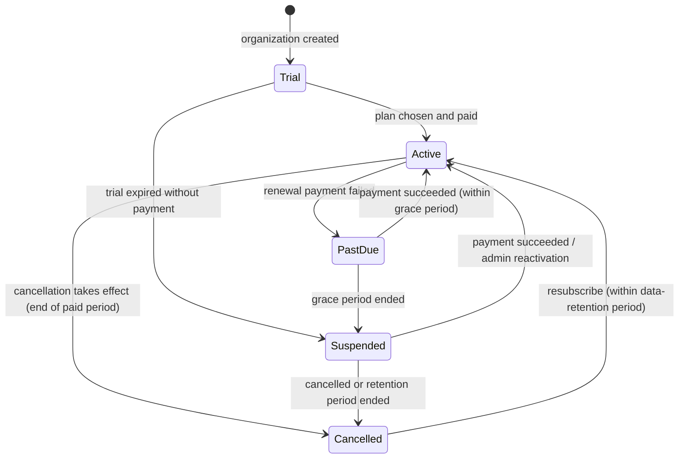

# Subscriptions and SaaS billing (design)

> **Status:** design only. Nothing in this document is implemented in Phase 1.
> Phase 2 implements plans, entitlements, limits and manual subscription administration.
> Phase 5 integrates a real payment provider. Until then no recurring payment is processed.

SaaS billing (organizations paying for BusinessSuite) is completely separate from the business invoices
that organizations issue to their own customers. Different tables, services and modules.

## 1. Concepts

| Concept | Description |
|---|---|
| **SubscriptionPlan** | A commercial offer (code, name, price per interval, currency, active, public/private). |
| **PlanEntitlement** | A feature flag or numeric limit attached to a plan, e.g. `limits.users = 5`, `features.api = false`. |
| **OrganizationSubscription** | The organization's current plan, status, dates, billing interval and provider reference. |
| **SubscriptionHistory** | Append-only log of every status or plan change (who, when, why). |
| **SubscriptionPaymentEvent** | Raw, verified webhook events from the payment provider (Phase 5), unique per provider event id. |

## 2. Example plans (configurable data, not hard-coded rules)

| Entitlement key | Trial | Starter | Professional | Business | Enterprise |
|---|---|---|---|---|---|
| `limits.users` | 3 | 3 | 10 | 25 | custom |
| `limits.branches` | 1 | 1 | 3 | 10 | custom |
| `limits.products` | 500 | 1,000 | 10,000 | 50,000 | custom |
| `limits.invoices_per_month` | 200 | 500 | 5,000 | 25,000 | custom |
| `features.reports_advanced` | yes | no | yes | yes | yes |
| `features.data_export` | no | no | yes | yes | yes |
| `features.batch_expiry` | yes | no | yes | yes | yes |
| `features.api_access` | no | no | no | yes | yes |
| `audit.retention_days` | 30 | 90 | 365 | 730 | custom |

Numbers are placeholders for planning. Plans and entitlements are rows in the database, edited by platform
administrators; adding a plan never needs a code change.

## 3. Lifecycle

| Status | What users can do | Notes |
|---|---|---|
| Trial | Everything in the trial plan | Trial length configurable (e.g. 14 days); reminder before expiry |
| Active | Everything in the plan | |
| PastDue | Everything, with a payment banner | Grace period configurable (e.g. 7 days); retries by provider |
| Suspended | Sign in, view and export data, pay; **no** new transactions | Protects data while stopping service |
| Cancelled | Read-only until the retention period ends, then data is archived/deleted per policy | Owner can export data |

Plan changes: upgrades apply immediately (prorated by the provider when available). Downgrades apply at the end
of the paid period and are refused if current usage exceeds the new plan's limits (e.g. 8 users on a 3-user plan).

## 4. Enforcement (server-side, Phase 2)

* An `IEntitlementService` in the Application layer answers `HasFeatureAsync(feature)` and
  `CheckLimitAsync(limit, additionalUnits)` for the current organization.
* Use cases call it **before** changing data, e.g. `CreateUser` checks `limits.users`, `ConfirmInvoice`
  checks `limits.invoices_per_month` and the subscription status. A failure returns
  `Error.Forbidden("Subscription.LimitReached", "...")` with an upgrade hint.
* The menu and buttons also hide unavailable features, but hiding is never the enforcement.
* A `SubscriptionStatusFilter` (or policy) blocks write actions for Suspended/Cancelled organizations.
* Usage counters are calculated from data (count of active users, invoices this month in the organization's time zone),
  not from client input.
* Unit tests cover each lifecycle transition and limit; integration tests cover enforcement on real endpoints.

## 5. Payment provider integration (Phase 5)

* Behind an `IPaymentProvider` interface in Application; one adapter per provider in Infrastructure, so the
  provider can be chosen based on availability in the target market (local gateways, cards, bank transfer).
* No card data ever touches BusinessSuite servers (hosted checkout / tokenisation only).
* Webhooks: verify the signature, store the raw event with a unique `(Provider, ProviderEventId)` constraint
  (idempotency), process it in a background job with retries, and record every resulting subscription change.
* Manual payments (bank transfer) are recorded by platform administrators with the same history and audit trail.
* Do not describe recurring billing as operational until a provider is integrated and tested end-to-end.
